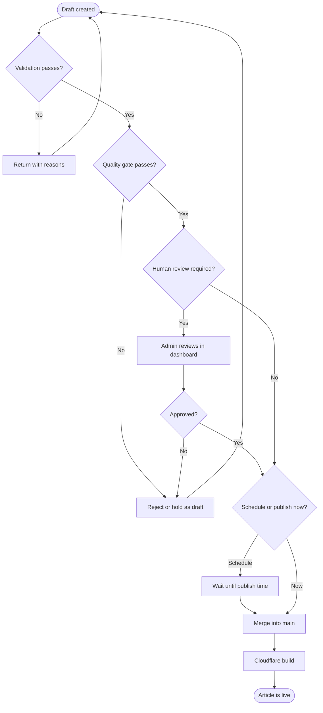

# Activity: publish workflow

The end-to-end path from a draft to a live article, including the quality
gate and the human review branch.

## Rules

- Validation covers structure: title, description, minimum body length, image
  alt text, no placeholder tokens.
- The quality gate covers meaning: duplication, thin content, unsupported
  claims.
- Human review is reserved for articles that are promoted on the landing page
  or that touch money, health, or safety claims.
- Only the merge step publishes. Everything before it is reversible.
