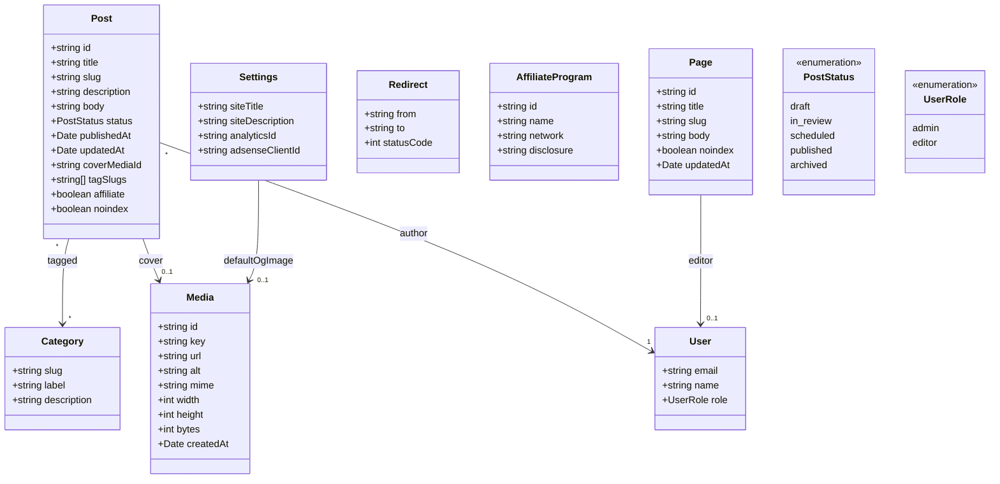

# Domain model

The entities the system persists and their relationships.

## Field rules

- `slug` is unique across `Post` and `Page`, and is the URL identity. Changing
  it requires a matching `Redirect` from the old path.
- `Media.alt` is required for any image referenced as a cover.
- `Post.status` drives visibility; only `published` appears on the public site.
- `User.email` is the identity key, so a future custom login can be reconciled
  with Cloudflare Access by matching email.
- `Settings` is a singleton.
