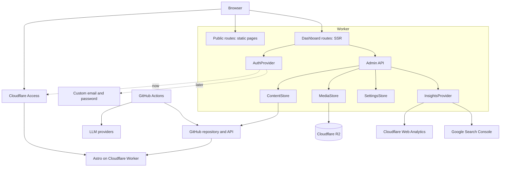

# Component diagram

How the parts of the system are organized and who calls whom.



## Interface note

`ContentStore`, `MediaStore`, and `SettingsStore` are interfaces, not concrete
implementations:

```text
ContentStore     savePost, getPost, listPosts, deletePost
MediaStore       put, get, list, delete
SettingsStore    read, write
AuthProvider     getCurrentUser, requireAdmin
```

Implementations today:

- `ContentStore` -> git adapter (Markdown committed to the repository)
- `MediaStore` -> Cloudflare R2
- `SettingsStore` -> JSON file in the repository
- `AuthProvider` -> Cloudflare Access

A future swap to a database changes only the adapter, not the callers.
