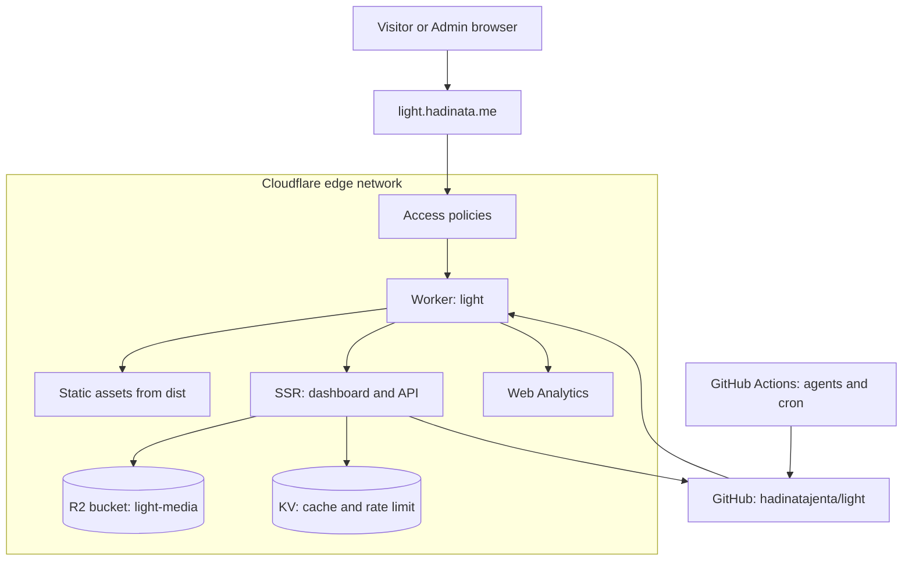

# Deployment diagram

Where each part runs in production.

## Notes

- The public site is served as static assets; only `/dashboard` and `/api`
  run server-side.
- Server secrets live as Worker secrets: GitHub token, R2 credentials,
  Access verification key. Never in the repository.
- The agent pipeline runs in GitHub Actions, not in the Browser Worker,
  because it is long-running and needs outbound calls to LLM providers.
- Content changes reach production by commit, which triggers a build.
  Publishing is batched, not one build per article.
- A database (D1) is intentionally absent for now. When the catalog passes
  the migration threshold in the content plan, D1 replaces the git adapter
  behind `ContentStore` and article rendering moves to on-demand.
