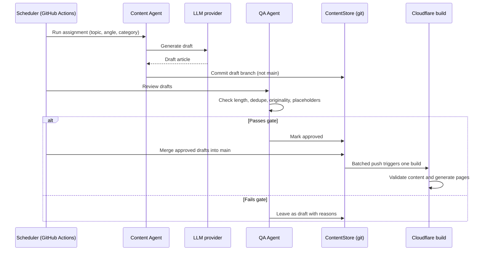

# Sequence: agent batch publish

Multiple content agents produce drafts on a schedule. A quality gate decides
what reaches the repository, and publishing is batched so one build covers
many articles.

## Rules

- Agents never push to `main` directly. They write to a branch; a merge step
  publishes. This keeps `main` clean and limits conflict windows.
- The quality gate is mandatory. At volume, review cannot be a human reading
  every article; it is an automated gate with a sampled human check.
- Publishing is batched. One build per article wastes build minutes and gives
  no benefit for a content site.
- The gate must reject rather than repair silently. Repairs belong in the
  agent, not in the gate.
