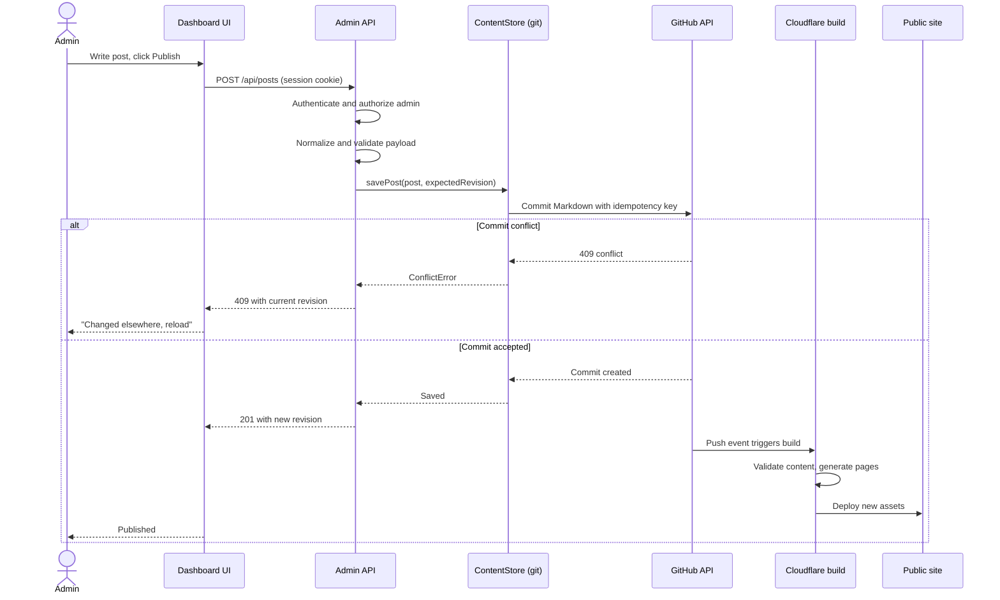

# Sequence: publish a post

An admin writes in the dashboard and publishes. Content is committed to the
repository, which triggers a build.

## Rules

- The request carries no author identity; the author is taken from the session.
- An `Idempotency-Key` prevents a double click from creating two commits.
- The expected revision makes the write optimistic, so a concurrent change is
  reported rather than silently overwritten.
- Validation runs before the commit: title length, description length, minimum
  body, and image alt text.
