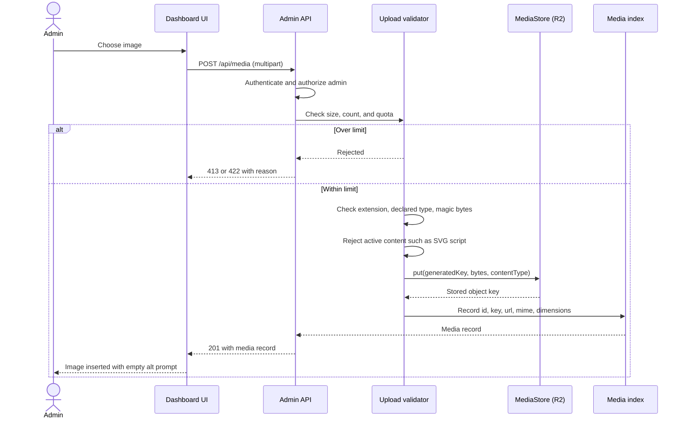

# Sequence: upload media

An admin uploads an image. The file is validated before it is stored, and the
stored name is generated, never taken from the client.

## Rules

- Never trust the filename or the declared content type. Check the magic bytes.
- Generate the storage key. Never build a path from user input.
- Enforce a size limit, a count limit, and a total quota per admin.
- Serve uploads from R2, not from the same origin as HTML, so a stored file
  cannot become active content on the site domain.
- `alt` is required before the image can be saved as a post cover.
