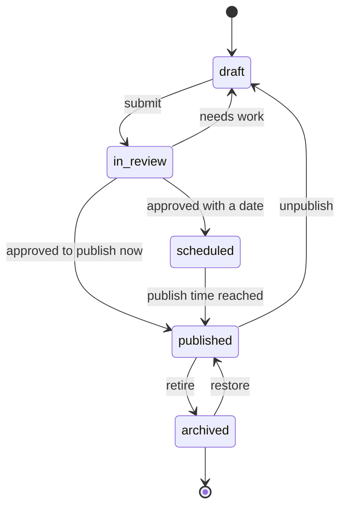

# State: post lifecycle

The states a single post moves through.

## Transition rules

| From | To | Who | Condition |
| --- | --- | --- | --- |
| draft | in_review | Admin or agent | Validation passes |
| in_review | draft | Admin or QA gate | Rejected with reasons |
| in_review | published | Admin | Approved, no schedule |
| in_review | scheduled | Admin | Approved with a future date |
| scheduled | published | Scheduler | Publish time reached, validation still passes |
| published | draft | Admin | Unpublish |
| published | archived | Admin | Retire old content |
| archived | published | Admin | Restore |

Only `published` is visible on the public site. `scheduled` becomes published
by a scheduled job, not by a client request.
