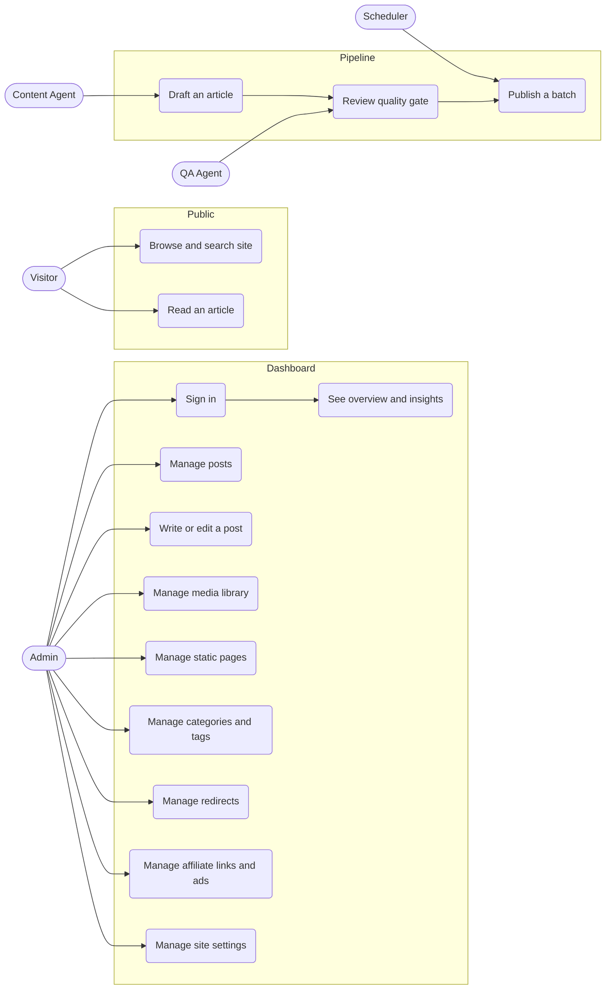

# Use cases

Actors and the use cases they drive. Mermaid has no native use-case
diagram, so this is drawn as a flowchart with actors and use-case ovals.

## Actor detail

| Actor | Description | Trust level |
| --- | --- | --- |
| Visitor | Anonymous reader of the public site | Untrusted |
| Admin | The site owner, authenticated through Cloudflare Access | Trusted |
| Content Agent | Automated writer producing drafts | Untrusted output, gated |
| QA Agent | Automated quality gate over drafts | Untrusted output, gated |
| Scheduler | Cron trigger for batch work | Internal |

## Abuse cases to hold against the design

| Use case | Abuse case |
| --- | --- |
| Sign in | Credential stuffing, session fixation, replay after logout |
| Manage posts | Edit a post the caller does not own, inject script through title or body |
| Manage media | Upload an executable, an SVG script, an oversized file, path traversal in filename |
| Manage redirects | Open redirect to an attacker host |
| Manage settings | Inject HTML into a meta field, escape into a template |
| Publish a batch | Flood the pipeline, publish unreviewed content, exhaust the LLM quota |
