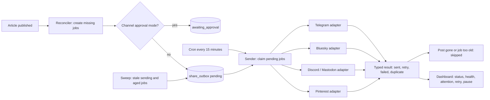

# Plan: auto-share published articles

Status: FINAL (frozen after four review rounds). Implementation started.
Owner: engineering
Related: agents pipeline, media covers, scheduled publishing, spending budget

## 0. Freeze note

This plan is frozen. Review no longer reopens for suggestions; it reopens only
if a correctness bug is found in the current rules. Feature and polish ideas go
to a backlog. The next reviewer is the code and its tests.

Final revision resolved:

- Retention removed (it could make the reconciler re-share old posts).
- Eligibility anchored to the post timestamp, plus a channel start time.
- `published_at` migration backfill and a transition-only write condition.
- Fairness moved inside the claim query; per-job deadline; unprocessed rows
  returned without a failure.
- One rule for `channel_config`; defined what clears `needs_attention`.
- Channel-level rate limiting via `paused_until`.
- Manual actions reset the age baseline.
- Hard-deleted posts handled by a LEFT JOIN and a pre-send check.
- Daily cap increments on success only.
- Slug-change scanning deferred to a later phase.

Deferred to "Decide during implementation" (section 20): Discord host allowlist,
concrete secret sanitization, reconciler query cost, cron subrequest limits,
alerting, `RETURNING` row order, backoff quantization note.

## 1. Goals and non-goals

Goals:

- Share every newly published article to the enabled channels, once per article
  per channel at the job level, best effort at the platform level.
- Never block publishing. Sharing is asynchronous and can be inspected,
  retried, paused, or disabled per channel.
- Attach UTM parameters so clicks can be attributed per channel.

Non-goals:

- Not a full social scheduler. No manual queue, no per-timezone scheduling.
- No reply or DM management, no deep analytics, no audience targeting.
- No re-share when an article is edited, no automatic unshare, no re-share on
  re-publish by default.
- No threading or multi-post series.
- Not a guarantee of traffic.

## 2. Flow



## 3. Runtime wiring

- New endpoint `POST /api/agents/share-due`, same cron bearer token as `run-due`.
  Extract the timing-safe token check into a shared helper used by both.
- The cron Worker makes a second fetch to `share-due` on each tick, in a
  `try/finally` so a `run-due` failure or timeout does not skip sharing.
  Generalize `triggerRun` to `trigger(url, timeout)` and add `AGENT_SHARE_URL`.
  The Worker request timeout must exceed the share budget plus margin.
- `share-due` runs reconcile, sweep, claim, send in order.
- Budgets: `SHARE_BUDGET_MS = 90_000`, `SHARE_MAX_JOBS_PER_TICK = 5`,
  `SHARE_PER_CHANNEL_PER_TICK = 2`, `SHARE_JOB_DEADLINE_MS = 25_000`, and a
  jittered delay of one to two seconds between jobs.
- Per-job deadline: each job gets
  `deadline = min(now + SHARE_JOB_DEADLINE_MS, run deadline)`, or the remaining
  budget divided by the remaining jobs, whichever is smaller. Every HTTP call in
  the job uses `timeout = min(10_000, deadline - now)`.
- End of run: claimed rows that were not processed before the run deadline are
  returned to `pending` without incrementing `failures` (and with `attempts`
  decremented), so they are retried next tick instead of waiting for the sweep.
- The global pause `share_paused` stops the sender as well as the reconciler.

Requires D1 (same assumption as the agents, `requireContentDatabase`).

## 4. Data model (new migration)

`share_channels`:

- `id`, `provider`, `label`, `enabled`, `config` (JSON), `daily_cap`
  (nullable), `require_approval` (0/1), `needs_attention` (0/1), `paused_until`
  (text), `started_at` (text), `last_error` (sanitized), `last_success_at`
  (text), `created_at`, `updated_at`.
- `config` separates secret and non-secret fields. Secrets (tokens, webhooks)
  are encrypted; non-secrets (chat id, board id, base url) are plain. Editing a
  save that changes only non-secret fields preserves the stored secret.
- `started_at` is set when the channel is first enabled, and bounds eligible
  posts for that channel.
- `paused_until` is set by a channel-level rate limit.

`share_outbox`:

- `id`, `post_id`, `channel_id`, `status`, `attempts`, `failures`,
  `rate_limit_hits`, `next_attempt_at`, `age_reset_at`, `locked_at`,
  `provider_post_id`, `shared_url`, `error` (sanitized), `created_at`,
  `updated_at`.
- Status: `pending`, `sending`, `sent`, `failed`, `awaiting_approval`,
  `skipped`.
- `shared_url` stores the base article URL without UTM (audit and future use).
- `age_reset_at` is set by a manual Retry or Approve so a manual action is not
  immediately skipped by the maximum age.
- Unique index on `(post_id, channel_id)`.

Indexes:

- `idx_share_outbox_due (status, next_attempt_at)`
- `idx_share_outbox_post (post_id)`
- `idx_posts_status_published (status, published_at)`

No retention in Phase 0. Row count is posts times channels (small). A later
cleanup may delete rows only for posts that no longer exist.

Settings: `share_backfill_cutoff`, `share_paused`, `share_max_age_days`
(default 14).

`posts` gains `published_at TEXT`, with a backfill for existing posts:
`UPDATE posts SET published_at = COALESCE(pub_date, created_at)
WHERE status = 'published' AND published_at IS NULL`.

## 5. Reconciler, eligibility, and `published_at`

- Eligibility uses the post timestamp, not the row timestamp. A post is
  eligible when
  `COALESCE(datetime(published_at), datetime(pub_date), datetime(created_at)) >=
  max(share_backfill_cutoff, channel.started_at, now - share_max_age_days)`.
  `datetime()` makes an unparseable `pub_date` fall through instead of yielding
  NULL. Anchoring to the post timestamp prevents retention or a newly enabled
  channel from re-sharing old posts.
- Reconciler inserts one `pending` (or `awaiting_approval`) row per eligible
  published post per enabled channel, ignoring conflicts.
- `published_at` write paths and conditions:
  - `review.ts` `publishPost`: `published_at = COALESCE(published_at, ?)`.
  - `scheduling/store.ts` `publishDuePosts`: same.
  - `content/d1-store.ts` `updatePost`: set `published_at` only on a transition,
    when the previous status is not `published` and the new status is. A plain
    edit of an already-published post must not move `published_at`.
  - `content/d1-store.ts` `createPost`: set `published_at = now` when inserted
    with `status = 'published'`.
  - A test asserts each path sets it and that an edit does not move it.
- `share_backfill_cutoff` is captured when the first channel is enabled.
- When `share_paused` is on, the reconciler creates no rows; the sweep still
  runs so stuck `sending` rows do not hang.
- Reconciliation marks `pending` and `awaiting_approval` rows `skipped` when the
  post is not published or no longer exists (LEFT JOIN on posts).

## 6. Sender: claim, lease, throttle, typed errors

Claim uses a window function for fairness, inside the SQL:

```
UPDATE share_outbox
SET status = 'sending', locked_at = ?, attempts = attempts + 1
WHERE id IN (
  SELECT id FROM (
    SELECT o.id, o.next_attempt_at,
      ROW_NUMBER() OVER (PARTITION BY o.channel_id ORDER BY o.next_attempt_at) AS rn
    FROM share_outbox o
    JOIN share_channels c ON c.id = o.channel_id
    WHERE o.status = 'pending'
      AND o.next_attempt_at <= ?
      AND c.enabled = 1
      AND c.needs_attention = 0
      AND (c.paused_until IS NULL OR c.paused_until <= ?)
      AND (c.daily_cap IS NULL OR (
        SELECT COALESCE(SUM(u.count), 0) FROM usage_counters u
        WHERE u.kind = 'share:' || c.id AND u.day = ?
      ) < c.daily_cap)
  )
  WHERE rn <= ?
  ORDER BY next_attempt_at
  LIMIT ?
)
RETURNING *
```

- The daily cap and the pause are checked before claim, so no row is claimed
  when it cannot be sent. A single batch can overshoot a cap by at most the
  per-channel tick cap; this is explicit and acceptable.
- `needs_attention` and `paused_until` channels are excluded.
- The claim helpers use `RETURNING`, which is not used elsewhere in the repo.
  Run the smoke test (section 16) before building the sender.
- Lease and recovery: the sweep returns `sending` rows with `locked_at` older
  than `STALE_SHARE_MS = 10 minutes` to `pending` and increments `failures`. If
  that reaches `MAX_FAILURES`, the row goes straight to `failed`. The sweep does
  not set a new `next_attempt_at`; a reclaimed row is claimable next tick.
- Counters: `attempts` counts claims (informational); `failures` drives backoff;
  `rate_limit_hits` counts 429 responses. Deferrals do not touch `failures`.
- Backoff by `failures`: 1 minute, 5 minutes, 30 minutes, 2 hours. After the
  fifth failure the row is `failed`. Five failures have four gaps.
- Guarded writes: every status write uses
  `WHERE id = ? AND status = 'sending' AND locked_at = ?`. If the guarded `sent`
  write matches zero rows, log a duplicate warning.
- Typed adapter result:
  `success | channel_config | invalid_payload | rate_limited | transient`, with
  the global status-code mapping as the default the adapter can override.
  - `channel_config`: return the row to `pending` WITHOUT incrementing
    `failures`, and set the channel `needs_attention`. Clearing it: a successful
    Test send, or editing the channel secret/config. Test send is allowed on a
    flagged channel. (Single rule; there is no separate fail path.)
  - `invalid_payload`: fail only this job; the channel stays healthy.
  - `rate_limited`: increment `rate_limit_hits`; reschedule with
    `next_attempt_at = now + min(Retry-After, 1 hour)`. If the adapter can tell
    the limit is channel-level, also set `share_channels.paused_until`.
  - `transient`: increment `failures` and back off.
  - Adapters inspect the response body before deciding, so provider quirks are
    handled: Bluesky returns `ExpiredToken` as HTTP 400 (refresh the session
    once before deciding), and expired Pinterest tokens refresh.

## 7. Delivery semantics and provider idempotency

At-least-once. Mitigations:

- Bluesky: `putRecord` with a stable `rkey` stored on the row (generate once and
  persist; `putRecord` is idempotent).
- Mastodon: `Idempotency-Key` equal to the outbox row id (kept about one hour,
  shorter than the longest backoff).
- Telegram, Discord, Pinterest: no native idempotency; accept the duplicate risk
  and mark `sent` immediately after a 2xx.
- A duplicate response is treated as success, not as an `invalid_payload`.

## 8. Article lifecycle

- Unpublish or archive: reconciliation marks `pending` and `awaiting_approval`
  rows `skipped`; no new rows while not published.
- Re-publish: a `skipped` row stays skipped; manual Retry can revive it.
- Hard delete: reconciliation LEFT JOIN marks orphaned rows `skipped`, and the
  sender re-checks that the post exists and is published before sending.
- Channel disable: excluded at claim and reconcile, not skipped.
- Channel `needs_attention` or `paused_until`: excluded at claim.
- Maximum age: a `pending` or `awaiting_approval` row whose base time
  (`COALESCE(age_reset_at, created_at)`) is older than `share_max_age_days`
  becomes `skipped`. Manual Retry or Approve sets `age_reset_at = now` so it is
  not immediately skipped.
- Edit: no re-share. Slug-change detection is deferred (section 20).
- Approval per channel: turning `require_approval` off flushes that channel's
  `awaiting_approval` rows to `pending`.

## 9. Channel matrix

| Channel | API | Auth | Cost | Rate limit | Risk | Click potential | Effort |
| --- | --- | --- | --- | --- | --- | --- | --- |
| Telegram | Bot API sendMessage/sendPhoto | Bot token and chat id | Free | About 30 messages/second | Low | Low to medium | Small |
| Bluesky | com.atproto.repo.putRecord, hand-rolled facets | App password | Free | Rate limited | Low | Medium | Medium to high |
| Discord | Webhook | Webhook URL | Free | About 30 per minute | Low | Low | Small |
| Mastodon | POST /api/v1/statuses | Access token per instance | Free | Default 300 per 5 minutes | Low | Low to medium | Small |
| Pinterest | API v5 POST /pins | OAuth2 plus business account | Free | Rate limited | Medium | High for this niche | Medium to high |
| X (Twitter) | API v2 POST /2/tweets | OAuth | Paid | Tight | High | Medium | Large |

Phase 0 ships Telegram only. Others follow.

## 10. Templates and UTM

- Per channel template with `{title}`, `{description}`, `{url}`, `{cover}`.
- Per-channel text limits: Telegram text 4096 and photo caption 1024, Discord
  2000, Mastodon 500 (instance-dependent), Bluesky 300 graphemes and about 3000
  bytes. Never truncate the URL.
- Telegram: HTML parse mode with `&`, `<`, `>` escaped. Telegram is the Phase 0
  adapter.
- Bluesky: hand-rolled minimal AT Protocol client (session, uploadBlob,
  putRecord) with `fetch`; no `@atproto/api`. Link facets use UTF-8 byte
  offsets. Image thumbnails must fit about 1 MB; resize or omit the thumbnail.
  Session: store the app password (encrypted), create a session on demand, cache
  it in memory for its lifetime; never persist the JWT.
- UTM: `utm_source=<channel>&utm_medium=social&utm_campaign=autoshare`, merged
  correctly when the URL already has a query. `shared_url` stores the base URL.
- Cover: absolute public URL from the site origin. For Pinterest, without a
  cover the job defers (section 8).
- Affiliate disclosure: reuse `AFFILIATE_LINK_MARKER` (`](product:`) and
  `PRODUCT_REFERENCE_PATTERN` plus the `posts.affiliate` flag, with a test for
  disagreement. Phase 0 (Telegram) can use the flag.
- Empty description: fall back to a truncated first sentence.

## 11. UI (Phase 0b)

- Sharing card or page: channels list, add, edit, remove, per-channel enable,
  daily cap, approval toggle, Test send (confirmation plus a marked test
  template), and a template editor. Non-secret config editable; secrets masked
  and preserved when unchanged.
- Channel health: `needs_attention`, `last_error`, `last_success_at`.
- Outbox log: status, time, error, Retry (resets counters and `age_reset_at`;
  hidden for `sent`), Approve for `awaiting_approval`.
- Global pause toggle. Channel delete clears the stored secret.

Phase 0a ships the admin JSON API; the React UI is Phase 0b.

## 12. Security

- Secrets encrypted with AES-GCM via `AGENT_SECRET_KEY` and `secrets.ts`.
- Error strings stored in `error`, `last_error`, activity, and logs are
  sanitized by exact match against decrypted secrets plus provider patterns
  (Telegram `bot<id>:<token>`, Discord webhook path). Applied everywhere, not
  only the outbox.
- Discord host restricted to its webhook domains. Mastodon base URLs are user
  supplied, so https only, pass the shared SSRF guard, and re-check after
  redirects.
- Masked display only. Endpoints admin or cron-token only. Test sends rate
  limited via `usage_counters` (kind `share_test`).
- Rotation: set the new key and re-enter secrets, or run an optional re-encrypt
  script. Pinterest refresh rewrites `config` atomically.

## 13. Observability and control

- Activity: `share.sent`, `share.failed`, `share.skipped`.
- Counters in `usage_counters` (kind `share:<channelId>`), keyed `(day, kind)`.
  Incremented only on a 2xx. The budget engine reads only `search`, `model`,
  `cover`; `share:<channelId>` is for the dashboard and the per-channel cap.
- Channel health on `share_channels`; the outbox holds per-row state.
- Global `share_paused`; per-channel `enabled`, `needs_attention`, `paused_until`.
- Alerting: there is no notifier in the repo. Phase 0 surfaces state on the
  dashboard and activity; a notifier is a follow-up.

## 14. Risks and mitigations

| Risk | Impact | Mitigation |
| --- | --- | --- |
| Empty accounts mean near zero traffic | Unmet expectations | Honest KPIs, prioritize Pinterest, grow audience first |
| Platforms restrict automation | Tokens blocked | Rate limits, spacing, opt-in, approval |
| Duplicate platform posts | Spam | Provider idempotency, duplicate equals sent |
| Stuck `sending` job | Lost share | Lease plus sweep; crash counts as failure |
| Overlapping cron runs | Double processing | Atomic claim with RETURNING |
| Dead token hammered | Account risk | `needs_attention` excluded; `channel_config` returns to pending |
| One bad payload poisons a channel | Lost channel | `invalid_payload` is job-level |
| Re-sharing old posts | Spam | Eligibility anchored to post timestamp; no retention |
| Edit moves `published_at` | Wrong eligibility | Transition-only write plus backfill |
| Unprocessed claimed rows punished | Unfair failures | Return to pending without failure at run end |
| Channel-level 429 | Repeated 429s | `paused_until` excludes the channel |
| Old max-age job after manual Retry | No-op retry | `age_reset_at` |
| Secret leak in errors | Security | Exact-match sanitization everywhere |
| Paid channel cost (X) | Money | Off by default |

## 15. Benefits and KPIs

- Consistent distribution with no manual work, plus brand presence.
- Attribution through UTM.
- Reusable foundation for a newsletter and IndexNow.
- Social links are usually nofollow, so direct SEO lift is small.

KPIs: shares sent versus failed, click through rate by UTM, referral traffic per
channel, channel health.

## 16. Testing plan

Order: run the `RETURNING` smoke test first, before the sender.

- Smoke test `RETURNING`: `npx wrangler d1 execute light-content --local
  --command "UPDATE ... RETURNING ..."`. Record the result in the PR as
  evidence (the runbook is not repeatable in CI).
- Templates: escaping, grapheme and byte truncation, per-channel limits, UTM
  merge, base URL without UTM, empty description, affiliate disagreement.
- Reconciler: idempotent; eligibility with `published_at`, `pub_date`,
  `created_at`, and unparseable dates; a deleted row is not recreated after a
  would-be cleanup; a newly enabled channel does not re-share old posts; skips
  unpublished, archived, and deleted posts.
- `published_at`: each publish path sets it; editing a published post does not
  move it; the migration backfills existing posts.
- Sender: pure-function classification and backoff; guarded writes reject a
  stale lease; sweep returns stale `sending` and fails at threshold; unprocessed
  claimed rows return to pending without failure; daily cap defers; manual Retry
  resets `age_reset_at`; channel-level 429 sets `paused_until`.
- Adapters: Telegram typed outcomes with mocked fetch (success, channel_config,
  invalid_payload, rate_limited with Retry-After, transient).
- Endpoint: cron token required, budget and caps enforced, pause stops sending,
  remaining reported.

## 17. Phases and effort

- Phase 0a (this execution): migration (tables, `posts.published_at`, backfill,
  indexes); `src/lib/sharing` (types, channels, outbox, reconciler, sweep,
  sender, templates, Telegram adapter); `share-due` endpoint; cron-token helper;
  Worker wiring; `published_at` write paths; admin JSON API; tests; the
  `RETURNING` smoke test; `docs/agents.md` update.
- Phase 0b: React UI (channels, outbox, test send, pause).
- Phase 1: Bluesky, Discord, Mastodon, health UI, approval UI, alerting.
- Phase 2: Pinterest, including OAuth refresh.
- Phase 3 (optional): X, slug-change detection, notifier.

## 18. Related work (out of scope)

IndexNow via Cloudflare Crawler Hints, Search Console sitemap submission, and
automatic internal linking are cheaper and higher impact for traffic.

## 19. Open decisions

1. MVP channel: Telegram only for Phase 0a (fixed).
2. Approval mode: auto send by default, per-channel approval available.
3. Backfill: new posts only (recommended).
4. Alerting: dashboard and activity only for now, or add a notifier.
5. `RETURNING` smoke-test evidence: record the local run output in the PR.

## 20. Decide during implementation

- Discord webhook host allowlist (include `discord.com`, `canary.discord.com`,
  `ptb.discord.com`, and legacy `discordapp.com`).
- Concrete sanitization implementation and its coverage across surfaces.
- Reconciler query cost and whether to pre-filter by `published_at >= floor`
  before the `datetime()` expression.
- Cron subrequest and query limits (free versus paid) with the MVP channel set.
- Backoff quantization to the 15 minute tick (or move the cron to 5 minutes).
- `RETURNING` row order (re-sort in the application if order matters).
