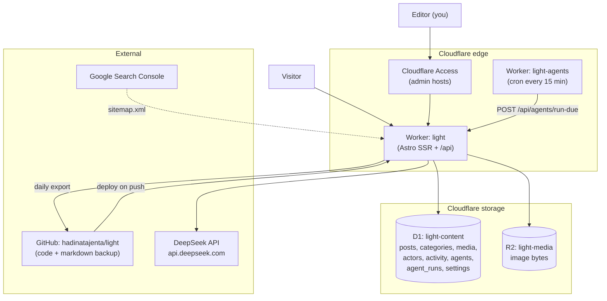
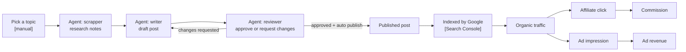

# light - master status and flow

This is the single source of truth for **where the project is right now**.
If you only read one file, read this one.

Related files:

- [task.md](task.md) - the checklist of what is done and what is next
- [techdebt.md](techdebt.md) - known debt and shortcuts
- [guides/](guides/README.md) - per-feature operator guides

The older diagrams in `UML/use-case`, `UML/sequence`, `UML/component`, etc.
describe the ORIGINAL design. The implementation moved on (git content became
D1, the scheduler became a Cloudflare cron Worker). See
[techdebt.md](techdebt.md#stale-uml-diagrams) for the list of stale diagrams.

---

## 1. What this is

`light` is idea 1 of the affiliate lab: an **English affiliate content site**
that publishes buying guides and product comparisons for home-office gear.

Money comes from two places:

1. Affiliate commissions from product links in articles.
2. Display advertising on the articles.

The site is paired with a custom admin CMS at `/dashboard` so content can be
produced and published without touching git by hand.

`star` (idea 2, an AI/SaaS directory plus a Pinterest funnel) is deliberately
on hold until `light` is finished.

## 2. The goal

| Item | Value |
| --- | --- |
| Revenue target | Rp100k per day (roughly $6) |
| Budget | Rp3jt, no VPS |
| Hosting | Cloudflare Workers, D1, R2 (free or near-free tiers) |
| Language | English content |
| Monetisation | Affiliate links plus display ads |

Reality check: Rp100k per day needs roughly 5,000 to 20,000 monthly visitors
in a niche that converts. A new domain with 7 articles is at the very start of
that curve. The bottleneck today is **content volume and monetisation setup**,
not tooling.

## 3. Live surfaces

| Surface | Host | Notes |
| --- | --- | --- |
| Public site | https://lightscripts.com | SSR from D1 |
| Public site (www) | https://www.lightscripts.com | 301 to the apex |
| Old public host | https://light.hadinata.me | 301 to lightscripts.com |
| Admin dashboard | https://admin.hadinata.me | Cloudflare Access protected |
| Admin dashboard (new) | https://admin.lightscripts.com | Attached, waiting for its own Access app |
| Media | https://lightscripts.com/media/&lt;file&gt; | Served from R2 |
| Cron Worker | `light-agents` | No public URL, runs every 15 minutes |

## 4. Architecture as built today



Key points:

- The public site is **server rendered from D1**. Publishing is instant because
  there is no rebuild step.
- Article bodies are markdown stored in `posts.body` and rendered at request
  time with `marked`.
- Git is the code source of truth and the **backup** for content, not the live
  content store.
- The admin dashboard is protected twice: Cloudflare Access at the edge, and
  the app middleware validating the Access JWT (fail-closed, returns 404 when
  there is no valid token).

## 5. The real end-to-end flow

This is the loop that actually produces money. Steps marked `[manual]` need a
human; the rest is automated.



What is missing to close this loop:

- The **affiliate step** is not wired. Article links still point to
  `example.com` and no tracking id exists.
- The **ads step** is not wired. `AD_CONFIG.network` is `none`.
- The **topic step** has no keyword plan yet.
- The agents exist and run, but no agent has been configured with a DeepSeek
  key yet.

## 6. Status checklist

### Done

- [x] Astro 7 project, TypeScript, Tailwind v4, React islands, shadcn/ui
- [x] Public site redesigned (magazine landing plus reading page)
- [x] Deployed to Cloudflare Workers
- [x] Custom domain `lightscripts.com` plus `www` (301 to apex)
- [x] `light.hadinata.me` 301s to the new domain
- [x] Cloudflare Access protecting the admin host
- [x] Content moved from git to **D1** (instant publish, no rebuild)
- [x] Media moved to **R2** plus metadata in D1, served at `/media/*`
- [x] Categories moved to D1
- [x] Admin CMS: posts table, editor with SEO panel, category manager, tags
      (the media library UI is still a placeholder, see below; the media API
      and the R2 storage are done)
- [x] Sidebar "New post" action
- [x] Dashboard overview with real data (hero metric plus sparkline plus chart)
- [x] **Activity log** for users and agents, with per-actor filtering
- [x] **Agents**: CRUD, four roles, encrypted DeepSeek key, manual run,
      review gate, scheduled cron Worker
- [x] D1 to markdown **backup** job (GitHub Actions, daily)
- [x] Sitemap with `lastmod` and tag pages, plus robots.txt
- [x] Search Console property verified (via Cloudflare)
- [x] 76 unit tests, `npm run verify` pipeline

### Not done yet

- [ ] **Media library UI** (upload grid, alt text, delete). The page is a
      placeholder; today you can only upload through the post editor toolbar.
- [ ] **Category and tag URL consistency.** The category editor previews
      `/tag/<slug>/`, but `/tag/[tag]` filters by post tags, not by the post
      category.
- [ ] **Ad slots beyond `in-article-top`.** `in-article-mid` and
      `in-article-bottom` are configured but rendered nowhere.
- [ ] **Affiliate catalog UI** and the Monetization menu. The tables and the
      link rewriting exist, but products must currently be inserted with SQL.
- [ ] **Writer agent uses the catalog.** The agent cannot reference products
      yet, so it does not emit affiliate links.
- [ ] **AdSense** (or another network) enabled with real slot ids
- [ ] Real `ads.txt`
- [ ] **Content volume**: only 7 published articles exist
- [ ] Keyword and topic plan for the next 90 days
- [ ] Search Console sitemap accepted (needs a re-submit)
- [ ] `admin.lightscripts.com` Access app, then remove `admin.hadinata.me`
- [ ] Pages menu (still a placeholder)
- [ ] Redirects menu (still a placeholder)
- [ ] Insights menu (placeholder, needs the Search Console API)
- [ ] Settings menu (still a placeholder)
- [ ] Agent cost and token reporting

## 7. Facts and identifiers

| Thing | Value |
| --- | --- |
| GitHub repo | `hadinatajenta/light` (branch `main`) |
| D1 database | `light-content`, id `9e14ae8a-5736-4458-b199-2deeb40abe8c`, region APAC |
| R2 bucket | `light-media` |
| Cron Worker | `light-agents` (cron `*/15 * * * *`) |
| Access team domain | `https://nameless-tree-67b1.cloudflareaccess.com` |
| Access audience | stored in `wrangler.jsonc` as `ACCESS_AUD` |
| Worker secrets | `GITHUB_TOKEN`, `AGENT_SECRET_KEY`, `AGENT_CRON_TOKEN` |
| Migrations | `0001_init`, `0002_activity`, `0003_agents` |
| D1 tables | `posts`, `categories`, `media`, `actors`, `activity`, `agents`, `agent_runs`, `settings` |
| Amazon Associates tracking id | `lightscripts-20` (program `amazon`, status approved) |
| Public host | `https://lightscripts.com` |
| Content today | 7 published, 1 archived |

## 8. Decisions log

| Decision | Why |
| --- | --- |
| Content in D1, not git | Publishing must be instant. Git caused a 1 to 2 minute rebuild per publish. |
| Git kept as backup | History and portability. A daily job exports D1 to markdown. |
| Media in R2, not D1 | D1 is relational and has a roughly 1 MB row limit. R2 is built for bytes. |
| Runtime markdown (`marked`) | Article pages are SSR from D1, so the build time MDX pipeline cannot be used. |
| One primary category plus tags | Simpler model, matches how the site presents topics. |
| Agents produce drafts; a reviewer approves before publish | Protects against prompt injection and low quality output. Enforced server side. |
| Cron Worker separate from the app | The Astro adapter cannot expose a `scheduled` handler. A tiny Worker triggers the app instead. |
| DeepSeek key encrypted in D1 | The owner sets it from the UI, so it cannot be a plain Worker secret. |
| Audience is the United States and EU, content in English | The site is already built for English readers with USD prices. Shopee targets Indonesian shoppers, so Shopee links here would waste the traffic. Decided 2026-10-11. |

## 9. How to verify progress

```sh
npm run verify          # content validation, types, lint, tests, build
npm run test            # 76 tests
npm run cf:db:migrate   # apply migrations to production
```

Check the live surfaces:

```sh
curl -I https://lightscripts.com/
curl -s https://lightscripts.com/sitemap.xml | head
curl -I https://admin.hadinata.me/dashboard
```

Check the agents:

```sh
npm run agents:tail     # live logs of the cron Worker
```

## 10. Next steps, in order

1. Register an affiliate program and obtain a tracking id.
2. Build the affiliate product catalog and link rewriting (so agents can emit
   real affiliate links).
3. Write the keyword and topic plan (50 to 100 titles).
4. Save the DeepSeek key and run the agent pipeline on real topics.
5. Turn on ads once there is traffic.
6. Re-submit the sitemap and start reading Search Console data.

See [task.md](task.md) for the full breakdown.
