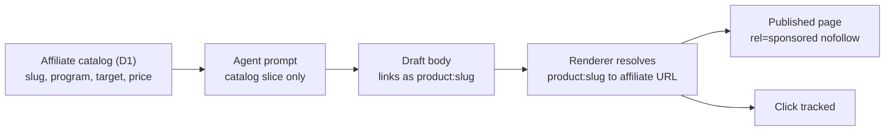

# monetization-plan.md - how the money side will work

The current state is in [guides/monetization.md](guides/monetization.md). This
file is the **plan** for what the Monetization menu becomes and how the agents
get real affiliate links.

---

## 1. The core idea: agents never invent links

The model must never write an affiliate URL itself. If it does, you get dead
links, links with no tracking id, and links you cannot audit.

Instead:

1. You store products in an **affiliate product catalog** with a canonical
   target (a merchant URL, an ASIN, or a pre-built tracking link).
2. The agent is given only the relevant slice of the catalog, and it must
   reference a product by slug, never by URL.
3. The renderer resolves the slug into the real affiliate URL using the
   program's tracking id, and adds the correct attributes.

Why this is the right shape:

- A wrong or unknown slug is detectable, so a dead link cannot ship.
- Changing a tracking id updates every article at once, with no content edits.
- You can swap a merchant or a product without rewriting old posts.
- The agent has less to hallucinate, because it never handles URLs.

## 2. What the Monetization menu will look like

Five sections, each a real screen:

### Programs

The affiliate programs you belong to.

| Field | Example |
| --- | --- |
| Name | Amazon Associates |
| Network | amazon, shopee, impact, shareasale, partnerstack, direct |
| Tracking id | `lightscripts-20` |
| Status | pending, approved, rejected |
| Default disclosure | "As an Amazon Associate I earn from qualifying purchases." |
| Link template | `https://www.amazon.com/dp/{target}?tag={trackingId}` |

Actions: add, edit, pause, delete. A program cannot be deleted while products
reference it.

### Product catalog

The products the agents may recommend.

| Field | Example |
| --- | --- |
| Slug | `herman-miller-aeron` |
| Name | Herman Miller Aeron |
| Program | amazon |
| Target | `B08XYZ1234` (ASIN) or a full URL |
| Price | 1295.00 USD |
| Image | R2 URL |
| Topics / tags | chairs, ergonomics |
| Notes | "size B, no headrest" |

Actions: add, edit, delete, and a bulk import (paste a list of ASINs or URLs).
The slug is what agents reference. It must be unique and stable.

### Ad slots

| Field | Example |
| --- | --- |
| Network | none, adsense, ezoic, mediavine |
| Client id | `ca-pub-...` |
| Slot ids | per placement |
| Placements | in-article-top, in-article-mid, in-article-bottom, rail |
| ads.txt | editable content, served at `/ads.txt` |

The placements already exist in the layout (`src/config/monetization.ts`).

### Disclosure and compliance

- Global affiliate disclosure text, shown on any article that has affiliate
  links.
- Per-program override.
- A policy switch for `rel="sponsored nofollow"` (on by default).
- A reminder that Amazon requires the exact Associates sentence.

### Reports

Not built. Needs click tracking first. Planned columns: clicks per article,
clicks per product, estimated commission, and revenue per program.

## 3. Link building per network

| Network | How the link is built |
| --- | --- |
| Amazon | `https://www.amazon.com/dp/{ASIN}?tag={trackingId}` |
| Shopee | Shopee generates a short link per affiliate. Automation is limited, so store the pre-built short link as the target. |
| Impact | A tracking template with a `subId` for per-article attribution. |
| ShareASale | A tracking URL with a `afftrack` parameter. |
| Direct | Whatever the merchant provides; store the full URL. |

Rule: if a network cannot be built from a simple template, the catalog stores
the **finished** tracking URL instead of a target id. The renderer only needs to
know "is this a template or a finished link".

## 4. What you must do first

An affiliate link needs a tracking id from an approved program. Nothing can be
automated before that.

### Audience decision: DECIDED

**Target: United States and EU. Content in English. Monetise with Amazon
Associates, optionally Impact, and AdSense.**

Decided on 2026-10-11.

Why: the site is already English with USD prices aimed at a Western buyer.
Shopee converts Indonesian shoppers, so Shopee links on these pages would waste
the traffic. Shopee belongs to a separate Indonesian site, which is a future
idea, not `light`.

| Rejected option | Why |
| --- | --- |
| Indonesia plus Shopee | Would require rewriting the content, the language, and the audience. The site is already built for English readers. |

### Registration checklist

1. Amazon Associates: apply, then receive a tracking id such as
   `lightscripts-20`. Note the rule that you must make roughly 3 qualifying
   sales within 180 days or the account is closed. Also note the required
   disclosure sentence.
2. AdSense (or another network): apply once the site has a few more articles.
   Approval can take days.
3. Optional: Impact or ShareASale for software and services, which pay better
   than physical goods.

Keep the Shopee affiliate account for a future Indonesian site. Do not mix it
into `light`.

## 5. Build order once a tracking id exists

1. Migration for `affiliate_programs` and `affiliate_products`.
2. Program and catalog CRUD in the API and the Monetization menu.
3. Link resolution in `renderMarkdown`, including
   `rel="sponsored nofollow noopener"` and `target="_blank"`.
4. Give the writer agent the catalog slice and forbid raw URLs in the prompt.
5. Have the QC agent fail a draft that references an unknown product slug.
6. Enable the ad network and replace the placeholder `ads.txt`.
7. Add click tracking, then the Reports section.

## 6. Compliance notes to keep

- Every page with affiliate links shows the disclosure. Amazon requires its
  exact sentence when you use its links.
- Affiliate links carry `rel="sponsored nofollow"` so search engines treat them
  as paid.
- Never place affiliate links in emails or in a way the program forbids.
- Keep prices in the catalog, and refresh them, because quoting a stale price is
  both a bad user experience and a program violation on some networks.
